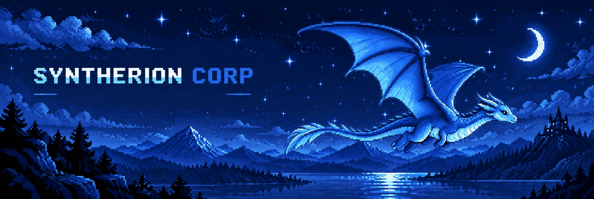

# SYNTHERION CORP

**TECNOLOGIA · INTELIGÊNCIA ARTIFICIAL · APRENDIZADO**

*Aprendendo hoje para construir as soluções de amanhã.*

---

### Olá! Sou o Lucas 👋

Estou aprendendo a programar e sou entusiasta do mundo da tecnologia e da inteligência artificial. Estou me preparando para cursar **Análise e Desenvolvimento de Sistemas na FATEC Paulínia**.

Meu sonho é trabalhar com tecnologia, transformar esse interesse em carreira e construir minha fonte de renda desenvolvendo soluções úteis. Também tenho interesse em explorar a conexão entre inteligência artificial e o mundo financeiro.

A **Syntherion Corp** é a identidade que estou construindo para reunir minhas ideias, experimentos e projetos. Este perfil acompanha minha evolução: aprendizado, tentativas, ajustes e novas descobertas.

### O que estou explorando

| Programação | Inteligência artificial | Produtos digitais |
| :--- | :--- | :--- |
| Aplicações web e fundamentos de desenvolvimento | Agentes, assistentes e automação | Interfaces, dashboards e ferramentas úteis |

### 🚧 Novo projeto em desenvolvimento

**Algo novo está sendo construído.**

Uma iniciativa da Syntherion Corp que conecta tecnologia, experiências digitais interativas e inovação, explorando novas possibilidades de interação em ambientes virtuais.

O projeto está em fase de desenvolvimento, com foco em arquitetura, experiência do usuário e construção de suas primeiras funcionalidades.

`Em desenvolvimento` · `Código privado` · `Em breve`

Mais detalhes serão revelados no momento certo. Este é apenas o começo.

---

**SYNTHERION CORP**  
O futuro começa com uma ideia.

